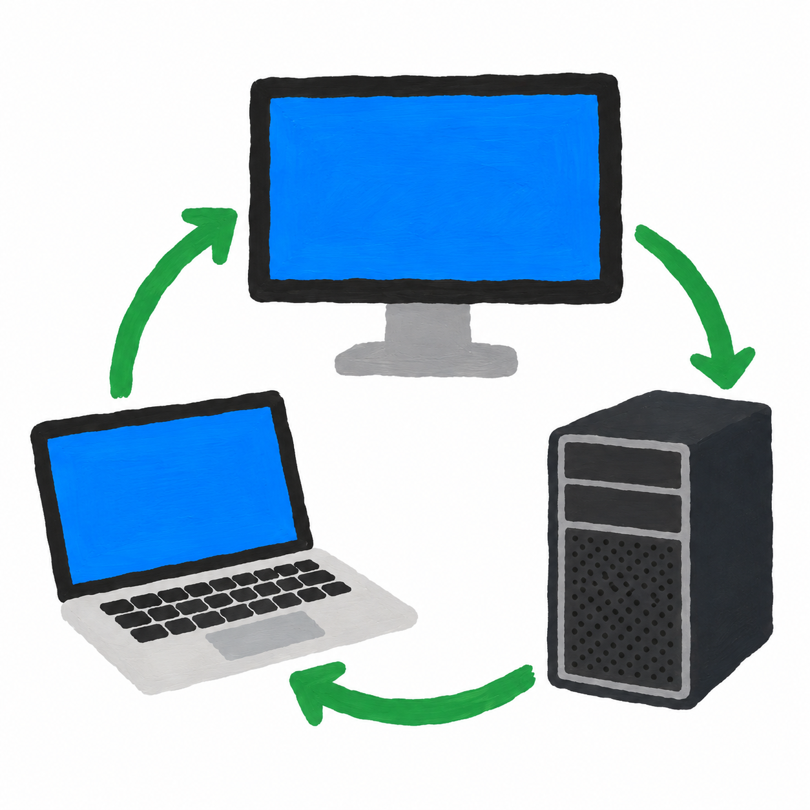

<div align="center">
  
  <h1>Pixovolt</h1>
  <p>Mac에서 모니터 입력을 바꾸고, 외부 화면 연결을 관리하세요.<br />Switch monitor inputs and manage external display connections from your Mac.</p>
  <p><a href="#한국어">한국어</a> · <a href="#english">English</a> · <a href="https://github.com/bbangchul/Pixovolt/releases/latest">Download</a></p>
  <p>Apple Silicon · macOS 13+ · SwiftUI · MIT</p>
</div>

## 한국어

**Pixovolt**는 Apple Silicon Mac용 모니터 입력 전환·연결 관리 앱입니다. 메뉴바 아이콘을 눌러 내려오는 제어 팝업에서 HDMI, DisplayPort, USB-C 입력을 전환하고 외부 화면을 이 Mac에서 연결 해제하거나 다시 연결할 수 있습니다.

### 설치

1. [최신 릴리스](https://github.com/bbangchul/Pixovolt/releases/latest)에서 `Pixovolt-1.1-arm64.dmg`를 내려받습니다.
2. DMG를 열고 **Pixovolt.app**을 **응용 프로그램** 폴더로 드래그합니다.
3. 앱을 실행합니다. 메뉴바 아이콘을 누르면 제어 팝업이 열립니다. 바깥을 누르면 닫히고 아이콘을 다시 누르면 열립니다.
4. 모니터 OSD에서 **DDC/CI**를 켜고 대상 모니터와 입력을 선택합니다.

이 빌드는 ad-hoc 서명이며 **Apple 공증이 없습니다**. macOS에서 실행을 차단하면 [Apple의 앱 안전하게 열기 안내](https://support.apple.com/102445)를 확인하세요.

### 기능

| 기능 | 설명 |
| --- | --- |
| 외부 모니터 탐지 | UUID로 대상을 구분하고 연결 변경·잠자기 복귀 시 목록 갱신 |
| 입력 전환 | HDMI 1/2, DP 1/2, USB-C |
| LG 대체 방식 | LG `input-alt` 지원, 모니터별 저장, 다른 방식으로 수동 재시도 |
| 연결 해제·복구 | 이 Mac의 외부 영상 출력을 해제하고 다시 연결 |
| 전역 단축키 | 기본 꺼짐. 활성화 시 기본 Control+Option+1~5, 조합·숫자 변경 가능 |
| 로그인 자동 실행 | 앱 설정에서 등록·해제, 시스템 승인 상태 표시 |
| 오류·진단 | 제어 팝업에 최근 결과 고정 표시, DDC 읽기 진단·오류 복사 |

앱 UI는 현재 한국어입니다.

### 화면 끄기와 전원 끄기의 차이

**외부 화면 끄기 (Mac 연결 해제)**는 모니터의 물리 전원을 끄지 않습니다. Mac의 영상 출력을 해제하므로 창이 노트북 화면으로 이동하고, 다른 컴퓨터가 연결돼 있으면 모니터가 그 입력으로 전환될 수도 있습니다.

- 내장 화면이 켜져 있을 때만 외부 화면 연결 해제를 허용합니다. 내장 화면과 미러링 화면은 변경하지 않습니다.
- 복구 대상은 미리 저장되어 앱을 다시 실행해도 **다시 연결** 버튼으로 복구를 시도할 수 있습니다.
- 복구되지 않으면 케이블을 분리 후 다시 연결하세요. 필요하면 로그아웃·로그인하세요.
- 화면 구성은 현재 로그인 세션에 적용합니다. 잠자기·덮개 개폐·재연결 후 macOS가 화면을 다시 추가할 수 있습니다.
- 고급 설정의 DDC 전원 명령은 모니터 호환성에 따라 다릅니다. 개발에 사용된 LG 모니터에서는 끄기 값 2/3/4/5가 작동하지 않았습니다.

### 끄기 방식 선택 (1.1.8)

DDC 전원 끄기는 모니터 UUID와 끄기 값(2/3/4/5)별로 **미확인·작동 확인·미작동 확인**을 저장합니다. 초기값은 미확인이며, 미확인 또는 미작동이면 **Mac 연결 해제**가 기본입니다. 현재 끄기 값에서 작동 확인을 직접 저장한 경우에만 기본 버튼이 DDC 전원 끄기로 바뀝니다. Mac 연결 해제도 별도로 선택할 수 있습니다.

고급 설정에서 끄기 값을 선택하고, 필요할 때 **DDC 전원 끄기 수동 시도**를 실행한 뒤 실제 화면을 확인하여 결과를 직접 저장하세요. 끄기 값이 바뀌면 그 값에 저장된 상태를 사용하며, 기록이 없으면 미확인입니다. 상태 변경·앱 시작·모니터 탐지는 전원 명령을 보내지 않습니다. EDID, 전송 성공, DDC 응답으로 작동 여부를 자동 판정하지 않습니다.

### 호환성

- Apple Silicon Mac / macOS 13 이상. **Intel Mac은 지원하지 않습니다.**
- 모니터·케이블·허브·연결 경로에 따라 DDC 동작이 달라집니다. DisplayLink, AirPlay, 가상 디스플레이는 지원 범위에 포함하지 않습니다.
- 입력 전환 명령 전송 성공은 실제 입력 전환을 확인했다는 뜻이 아닙니다. 다른 입력으로 바꾸면 현재 Mac의 영상이 끊길 수 있습니다.
- USB-C 입력 값은 일반 27 / LG 대체 210을 사용하며 모델에 따라 맞지 않을 수 있습니다.
- 연결 제어와 DDC는 비공개 macOS API에 의존합니다. 향후 OS 업데이트와 모든 기기 조합의 호환성을 보장하지 않습니다.
- 단일 사용자 환경에서 작동 피드백을 받았으며, 전체 기기·기능 검증표는 아직 없습니다. [검증 기록](docs/VALIDATION.md)을 참고하세요.

### 모니터 정보·입력 제어 프로필 (1.1.7)

모니터 정보를 JSON으로 읽고 제조사·제품 코드·일련번호·EDID 식별자 및 원본 EDID(제공되는 경우)를 수집합니다. 원본 EDID 기본 블록은 헤더와 체크섬을 확인한 뒤 사용하며, 없거나 유효하지 않으면 시스템이 제공한 식별 정보를 사용합니다. 이름이 없으면 제조사와 제품 코드로 표시하고 같은 이름의 모니터는 구분 번호를 붙입니다.

대상 모니터 아래 **모니터 정보 · 제어 프로필**에서 적용 중인 프로필과 선택 근거를 확인합니다. 선택 순서는 **사용자 저장 설정 → 모델 프로필 → 제조사 기본값 → 일반 DDC**입니다. 기존 LG 수동 설정은 사용자 설정으로 보존합니다. 일반/LG 방식과 입력별 값을 UUID별로 저장할 수 있으며, 입력 값은 0~65535만 허용합니다.

**입력 버튼과 전역 단축키는 선택한 모니터의 프로필 방식과 입력 값을 전송합니다.** 방식 변경과 입력 값 저장은 해당 모니터 UUID에 유지됩니다. 방식 변경 시 입력 값은 해당 방식 기본값으로 초기화됩니다. ‘다른 방식으로 재시도’도 프로필을 변경·저장하고 다시 전송합니다. 자동 선택 또는 초기화 시 기존 LG 수동 선택도 해제합니다. 명령 전달 성공은 실제 화면 전환 성공을 의미하지 않습니다. 자동 전환이나 전원 시험은 실행하지 않으며 EDID만으로 DDC 전원 지원을 판단하지 않습니다. 현재 모델 카탈로그는 기존 LG 환경용 설정 한 개와 제조사/일반 기본값으로 시작하며, 모든 모델을 지원한다고 가정하지 않습니다.

### 소스에서 빌드

Xcode와 Python 3가 필요합니다. 개발 환경은 Xcode 26.2 / Swift 6.2.3이며 Swift 5 언어 모드와 macOS 13 최소 대상을 사용합니다. Homebrew·XcodeGen·추가 패키지 설치는 필요하지 않습니다.

```bash
git clone https://github.com/bbangchul/Pixovolt.git
cd Pixovolt
./scripts/test.sh
./scripts/build.sh --dmg
```

- 앱: `outputs/Pixovolt.app`
- 설치 파일: `outputs/Pixovolt-1.1-arm64.dmg`
- Xcode: `Pixovolt.xcodeproj` → `Pixovolt` 스킴 → My Mac

m1ddc는 포함된 소스에서 빌드해 앱 내부에 서명·번들링합니다. 실행 중 별도 다운로드, 셸 명령 해석, 관리자 권한은 사용하지 않습니다. 화면 제어를 위해 App Sandbox는 비활성화돼 있습니다. 빌드 중간 파일은 `work/`에 생성하며 Git에서 제외합니다.

### 이전 이름에서 업데이트

이전 Monitor Switch 앱은 종료한 뒤 제거하고 Pixovolt를 설치하세요. 모니터 선택, LG 방식, 단축키, 복구 정보는 같은 Mac에서 최초 실행 시 가져옵니다. 로그인 자동 실행을 사용했다면 이전 앱에서 끈 뒤 Pixovolt에서 다시 켜세요.

### 라이선스·출처

- Pixovolt: [MIT](LICENSE)
- [waydabber/m1ddc](https://github.com/waydabber/m1ddc): [MIT](Vendor/m1ddc/LICENSE), [고정 커밋·수정 내역](Vendor/UPSTREAM.md)
- DMG 제작용 `ds_store`, `mac_alias`: [ds_store 라이선스](Vendor/ds_store-LICENSE), [mac_alias 라이선스](Vendor/mac_alias-LICENSE)
- 화면 연결 API 참고: [구현 메모](Vendor/DisplayConnection-NOTES.md)

---

## English

**Pixovolt** is a monitor input-switching and display-connection utility for Apple Silicon Macs. Open its control popover by clicking the menu bar icon to switch HDMI, DisplayPort or USB-C inputs, or software-disconnect and reconnect an external display.

### Install

1. Download `Pixovolt-1.1-arm64.dmg` from the [latest release](https://github.com/bbangchul/Pixovolt/releases/latest).
2. Open the DMG and drag **Pixovolt.app** into **Applications**.
3. Launch the app. Click the menu bar icon to open the control popover. Click outside to dismiss it, then click the icon to reopen it.
4. Enable **DDC/CI** in your monitor's OSD, select the monitor and choose an input.

This build is ad-hoc signed and **not notarized by Apple**. If macOS blocks it, refer to [Apple's guidance on opening apps safely](https://support.apple.com/102445).

### Features

| Feature | Details |
| --- | --- |
| Display discovery | UUID-based targets; refresh after connection changes and wake |
| Input switching | HDMI 1/2, DP 1/2 and USB-C |
| LG alternate mode | Per-monitor `input-alt` preference and manual retry with the other method |
| Disconnect/reconnect | Stop this Mac's video output to an external display and restore it |
| Global shortcuts | Off by default; Control+Option+1–5 when enabled, with configurable modifiers and number keys |
| Launch at login | Register/unregister through the app and view system approval status |
| Diagnostics | Persistent result/error display in the popover, read-only DDC queries and copyable errors |

The application UI is currently in Korean.

### Screen disconnect is not physical power-off

**외부 화면 끄기 (Mac 연결 해제)** means “Turn off external screen (disconnect from this Mac).” It stops this Mac's video output; it does not physically power off the monitor. Windows move to the laptop display, and a monitor connected to another computer may automatically switch to that computer.

- Disconnect is allowed only while the MacBook's built-in screen is active. Built-in and mirrored displays are not modified.
- Recovery information is saved before disconnecting, so the reconnect button remains available after restarting the app.
- If reconnect fails, unplug and reconnect the cable. Log out and back in if needed.
- Configuration changes apply to the current login session. macOS may restore a display after sleep, lid changes or reconnecting a cable.
- Advanced DDC power controls are monitor-dependent. Power-off values 2/3/4/5 did not work on the LG monitor used during development.

### Compatibility

- Apple Silicon / macOS 13 or later. **Intel Macs are not supported.**
- DDC support varies by monitor, cable, hub and connection path. DisplayLink, AirPlay and virtual displays are outside the supported scope.
- A successful write does not prove the monitor switched inputs. Switching to another input may interrupt this Mac's video connection.
- USB-C uses value 27 in standard mode or 210 in LG alternate mode; these values may differ between models.
- Display connection control and DDC depend on private macOS APIs and may break after OS updates.
- Successful use was reported in one user's environment, not across a complete device/feature matrix. See the [validation record](docs/VALIDATION.md).

### Identity and input control profiles (1.1.7)

Structured JSON discovery collects manufacturer/product IDs, serial information, EDID identity and raw EDID when available. The EDID base block header/checksum are validated; system metadata is used when raw EDID is absent or invalid. Missing model names fall back to manufacturer/product labels, and duplicate display names receive distinct numbers.

Expand **모니터 정보 · 제어 프로필** (Monitor information / Control profile) to inspect the active profile and selection reason. Precedence is **saved user settings → exact model profile → manufacturer default → standard DDC**. Legacy LG preferences retain user priority. Method and input values are saved per UUID, with values restricted to 0–65535.

**Input buttons and global shortcuts send the selected monitor’s profile method and input value.** Method changes and saved values persist per UUID. Changing methods resets port values to the chosen method’s defaults. Retry with the other method updates and saves the profile before sending. Automatic selection and reset clear legacy manual method overrides too. A successful command delivery does not confirm a physical input switch. No input/power tests run automatically; EDID alone does not establish DDC power support. The initial catalog has one configuration preset for the original LG setup, plus manufacturer/general defaults—not a complete supported-model database.

### Build from source

Requires Xcode and Python 3. Developed with Xcode 26.2 / Swift 6.2.3, using Swift 5 language mode and a macOS 13 deployment target. No Homebrew, XcodeGen or additional package installation is required.

```bash
git clone https://github.com/bbangchul/Pixovolt.git
cd Pixovolt
./scripts/test.sh
./scripts/build.sh --dmg
```

- App: `outputs/Pixovolt.app`
- Installer: `outputs/Pixovolt-1.1-arm64.dmg`
- Xcode: open `Pixovolt.xcodeproj`, choose the `Pixovolt` scheme and My Mac.

The bundled m1ddc executable is compiled from vendored source and signed during the build. Runtime operations use no shell command interpretation, separate downloads or administrator privileges. App Sandbox is disabled for display control. Build intermediates are stored in the Git-ignored `work/` directory.

### Upgrading from the previous name

Quit and remove Monitor Switch, then install Pixovolt. Monitor selection, LG mode, shortcuts and recovery data migrate on first launch on the same Mac. If launch at login was enabled, disable it in the old app and enable it again in Pixovolt.

### License and credits

- Pixovolt: [MIT](LICENSE)
- [waydabber/m1ddc](https://github.com/waydabber/m1ddc): [MIT](Vendor/m1ddc/LICENSE); [pinned revision and local fixes](Vendor/UPSTREAM.md)
- DMG build tools: [ds_store license](Vendor/ds_store-LICENSE), [mac_alias license](Vendor/mac_alias-LICENSE)
- Display connection API references: [implementation notes](Vendor/DisplayConnection-NOTES.md)

### 1.1.5 UI update / UI 변경

메뉴바에 붙는 제어 팝업으로 복귀했습니다. 연결 해제·DDC 전원 명령의 확인은 팝업 내부의 실행/취소 버튼으로 처리하여 별도 확인창 때문에 팝업이 닫히는 문제를 피합니다. 최신 결과는 앱 상태에 남아 팝업을 다시 열어 확인할 수 있습니다.

Controls now appear in a menu-bar popover instead of a standalone window. Disconnect and DDC power actions use inline confirmation buttons, avoiding focus changes to a separate alert. Results remain in application state after closing and reopening the popover.

### Power-off selection (1.1.8)

DDC power-off has three user-reported states: **unverified, working, not working**, saved per monitor UUID and off value (2/3/4/5). Unverified/not working defaults to Mac software disconnect. Only a manually recorded working result for the selected value makes DDC the default; software disconnect remains available.

Choose an off value in advanced settings, optionally run the manual DDC attempt, inspect the actual screen, then record the result. Unknown values start unverified. Saving status, launch and discovery never issue a power command. EDID, command delivery and DDC readback do not automatically establish physical power-off support.
